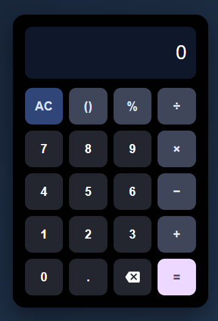

# Calculator

A clean, responsive calculator built with HTML, CSS, and JavaScript. Use it online or run it locally with no setup.

  <a href="https://dereck234.github.io/Calculator/"><strong>Open the live calculator →</strong></a>

## Preview

  

## Features

- Addition, subtraction, multiplication, division, and modulo
- Decimal input, nested parentheses, and implicit multiplication
- Safe expression parsing without `eval()`
- Keyboard support for numbers, operators, Enter, Backspace, and Escape
- Responsive layout for desktop and mobile

## Getting started

Open `index.html` in a modern browser. The project has no build step or external dependencies.

## Keyboard shortcuts

| Key | Action |
| --- | --- |
| `0–9`, `.` | Enter numbers |
| `+`, `-`, `*`, `/`, `%` | Enter operators |
| `(`, `)` | Enter parentheses |
| `Enter` or `=` | Calculate |
| `Backspace` | Delete the last character |
| `Escape` | Clear |

## Project structure

- `index.html` — calculator markup
- `styles.css` — layout and visual styling
- `calculator.js` — input handling and expression parser
- `assets/calculator-screenshot.png` — project preview
- `.github/workflows/pages.yml` — deploys the site to GitHub Pages on pushes to `main`
